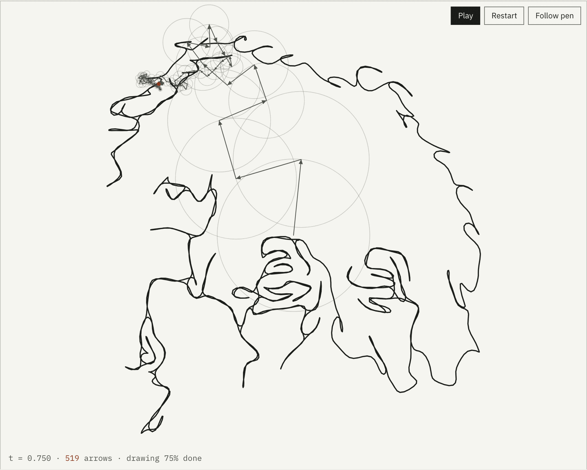

# Fourier Pen

A browser tool that finds the outlines in a picture, joins them into one continuous line, and redraws it with a chain of rotating arrows: a complex Fourier series you can watch, read and export.

[Live app](https://fourier-pen.vercel.app/) · [Write-up](https://fourier-pen.vercel.app/overview/)

The write-up has a working copy of the drawing: it imports the app's own edge, path and Fourier modules and runs them on the built-in examples, with a slider for the number of arrows.

Design and copy follow [these standards](https://github.com/lyhjeremy/lyhjeremy/blob/main/DESIGN_STANDARDS.md).



## The Einstein example

| Measure | Value |
|---|---|
| Edge pixels from the Canny detector | 4,775 |
| Strokes traced | 103 |
| Bridges joining them into one line | 102, totalling 562 px (hop mode needs 2,206 px of jumps) |
| Sample points, so arrows available | 2,048 |
| Share of the shape's energy with 10 / 31 / 2,048 arrows | 90.5% / 97.8% / 100.00% |
| Direct DFT time at N = 2,048 | 8 ms (21 ms at 4,096) |

Inspired by the epicycle drawings in 3Blue1Brown's "But what is a Fourier series?".

## What it does

You can upload, drop or paste a picture, pick one of five built-in examples, or type a short prompt and let an image model draw a line-art version first.

The strokes it finds are joined by the shortest bridges (a minimum spanning tree), and the pen retraces its own ink where it would otherwise lift, so the drawing is a single closed curve. A hop mode with straight pen jumps is there for comparison.

The math is shown live beside the drawing: the general formula, the three largest terms with their numbers filled in, the eight largest arrows in a table, and how much of the shape's energy the current arrow count captures.

Exports cover PNG at wallpaper sizes (iPhone, MacBook, Full HD, 4K, 5K or custom up to 8,192 px) in your own line and background colors, SVG, a CSV of every coefficient, and a WebM or MP4 video of one full drawing.

Uploaded pictures never leave the browser. The only thing sent to a server is a text prompt, which goes to this site's own function and on to Cloudflare Workers AI. See the [privacy page](https://fourier-pen.vercel.app/privacy/).

## Method

1. The picture is scaled to 360 px, converted to grayscale with a contrast stretch, and run through a hand-written Canny edge detector (Gaussian blur, Sobel gradients, non-maximum suppression, hysteresis).
2. Edge pixels are traced into strokes. Kruskal's algorithm over a spatial grid finds the shortest bridges between strokes, and an Euler tour of the doubled tree walks every stroke out and back, so the pen never lifts.
3. The closed path is resampled to N points (default 2,048) and treated as N complex numbers z_k.
4. A direct discrete Fourier transform gives c_n = (1/N) sum z_k e^(-2 pi i n k / N) for n from -N/2 to N/2 - 1. Each c_n is an arrow: |c_n| is its length, arg c_n its starting angle, n how many turns it makes per drawing.
5. Arrows are sorted largest first. The first K draw a smoothed version of the picture; all N draw it exactly. The slider is log-scaled, so 1, 30, 500 and 2,048 arrows are a short drag apart.

The direct O(N squared) transform is fast enough at these sizes (the page reports its own timing), so there is no FFT.

## Stack

The app is plain HTML, CSS and ES modules on a 2D canvas, with no framework or bundler. There is one Vercel serverless function for text prompts, calling Cloudflare Workers AI (FLUX.1 schnell) or Google Gemini; MediaRecorder handles video, and 18 Node tests cover the pure modules.

## How to run

No build step. Serve the folder with any static server:

```
npx serve .
```

The text prompt feature needs the serverless function and an image provider. The default is Cloudflare Workers AI, whose free plan allows 10,000 neurons a day (hundreds of FLUX.1 schnell images); past that, requests fail and nothing is billed. Google Gemini is supported too but has no free image quota.

```
cp .env.example .env.local     # put CF_ACCOUNT_ID and CF_API_TOKEN in it
vercel dev
```

Tests for the math and path modules run under Node with no dependencies:

```
node --test tests/
```

## Deploy

The site is a Vercel project; pushing to `main` deploys. Set `CF_ACCOUNT_ID` and `CF_API_TOKEN` (or `GEMINI_API_KEY`) in the project's environment variables. Without them the prompt button says prompts are not set up and everything else keeps working. Add a WAF rate-limit rule on `/api/generate` in the Vercel dashboard; the function also keeps a per-instance limit of 10 prompts per 10 minutes per IP, and `PROMPTS_ENABLED=false` switches the feature off without a deploy.

## Repo layout

| Path | Contents |
|---|---|
| `index.html`, `styles.css`, `js/` | The app: edges, path, fourier, render, exports, prompt, ui modules |
| `api/generate.js` | Serverless function for text prompts |
| `tests/` | Node tests for edges, path, fourier and exports |
| `overview/` | Write-up page and its screenshots |
| `docs/` | Spec, architecture, design, decisions and build plan |
| `handoff.md` | State file for picking the project up cold |

## Limitations

- Canny finds contrast and knows nothing about what is in the picture. Studio portraits on plain backgrounds work; cluttered snapshots come out as scribble.
- In continuous mode every stroke is drawn twice, so it needs about double the sample points for the same detail.
- Video export runs in real time and is capped at 1,920 px on the long side.
- Text prompts depend on a third-party model and its daily allowance.

## Credits

The Einstein example is the 1947 photograph by Orren Jack Turner, from the Library of Congress, public domain. Fonts are Source Serif 4, IBM Plex Sans and IBM Plex Mono, self-hosted.

## License

[MIT](LICENSE) © 2026 Jeremy Lee
